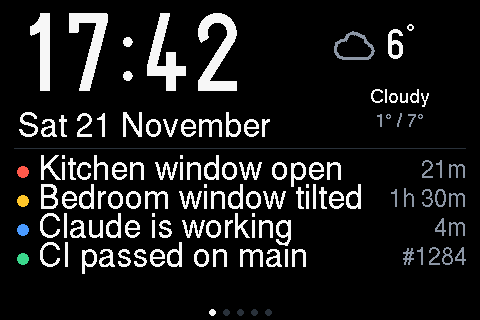
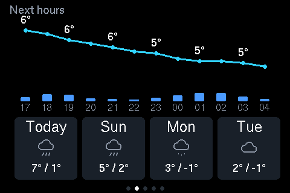
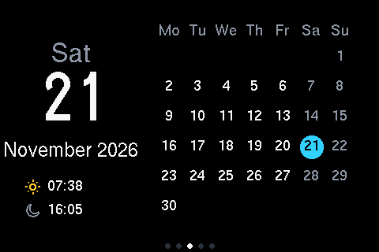
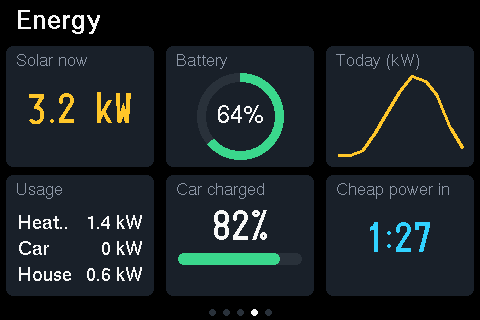
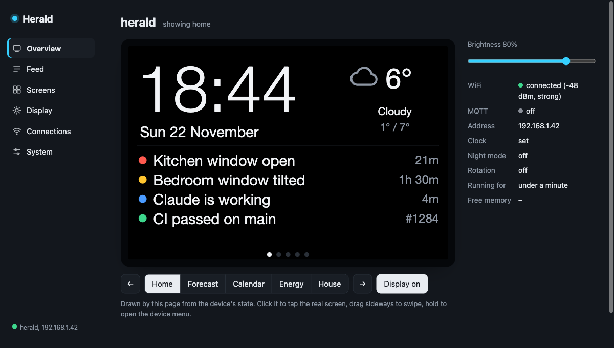
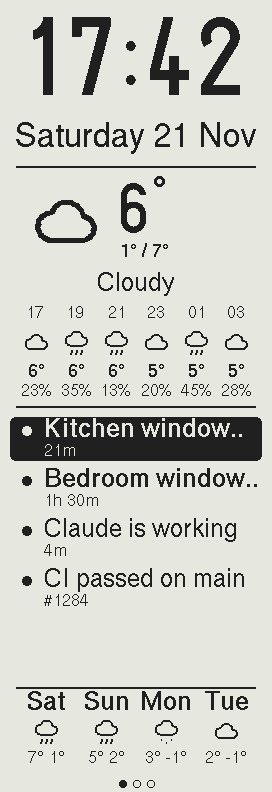

# Herald

[](https://github.com/bircni/esp32-herald/actions/workflows/ci.yml)
[](LICENSE)

A small status display for your desk. Herald is Rust firmware for ESP32
display boards that shows a clock, the weather and a feed of what your other
systems tell it: an open window, Claude Code waiting for input, a failed
build. It fetches nothing on its own; Home Assistant or any other MQTT
client sends it what to show.

<p align="center">
  
</p>

| Forecast | Calendar | A custom screen |
|---|---|---|
|  |  |  |



On the e-paper board, used upright, everything is on one tall page:

<p align="center">
  
</p>

## Features

- **Feed** of short items over MQTT or HTTP, most urgent first, with colours,
  icons and how long each state has lasted.
- **Weather and forecast** pushed from Home Assistant, plus a calendar view.
- **Custom screens** from 11 widget types (values, gauges, charts, lists,
  countdowns, …), sent as retained MQTT messages; they join the rotation.
- **Web app** with a live mirror you can tap, a screen builder, settings,
  logs and firmware updates over WiFi.
- **Night mode**, auto-rotation, a setup page that opens by itself on your
  phone, and Home Assistant-friendly messages (numbers may be strings,
  errors are reported on MQTT).

## Boards

| Board | Name | Screen | Input |
|---|---|---|---|
| Freenove ESP32 Display 3.5" (FNK0103) | `freenove-35` | 480x320 colour TFT | touch |
| Elecrow CrowPanel ESP32 5.79" E-Paper | `crowpanel-579` | 272x792 e-paper, upright | rotary switch, buttons |

Another board is one small crate with its pins and drivers; see
[Adding a board](docs/adding-a-board.md).

## Quick start

Try it on your computer first (needs Rust and SDL2, e.g. `brew install sdl2`):

```sh
LIBRARY_PATH=/opt/homebrew/lib cargo run -p simulator -- --demo
```

A 480x320 window opens (the mouse is your finger) and the web app runs at
<http://127.0.0.1:8080>. `--board crowpanel-579` shows the e-paper board
instead (arrow keys and Enter are its rotary switch).

To flash a board (by its name from the table above):

```sh
cargo install espup espflash ldproxy && espup install --targets esp32,esp32s3
. ~/export-esp.sh && cd firmware && make flash-freenove-35
```

On first boot (TFT board), tap the four calibration crosses, then join the `Herald-XXXX`
network with your phone and enter your WiFi. Later updates go over WiFi from
the web app.

## Sending things

Set your MQTT broker in the web app, then publish under the topic prefix
(`herald` by default):

| Topic | Payload |
|---|---|
| `herald/item/<id>` | `Front door open`, or JSON with `text`, `color`, `icon`, `since`, `ttl`, …; empty removes it |
| `herald/screen/<name>` | a custom screen: title and widgets |
| `herald/weather` | current weather and forecast, e.g. from a Home Assistant weather entity |
| `herald/view` | `home`, `forecast`, `calendar` or a screen name |

```sh
mosquitto_pub -h broker.lan -r -t herald/item/window.kitchen \
  -m '{"text":"Kitchen window open","color":"red","icon":"window"}'
```

The web app's Connections page lists every topic with your prefix filled in.

## Documentation

- [Using Herald](docs/guide.md): first boot, the web app, views, night mode,
  custom screens and all widgets.
- [MQTT and HTTP](docs/mqtt-and-http.md): every topic and field, weather,
  Home Assistant automations, the HTTP API and the Claude Code hook.
- [Development](docs/development.md): hardware, project layout, building,
  testing and design notes.
- [Adding a board](docs/adding-a-board.md): what a new board needs.

## License

[MIT](LICENSE)
