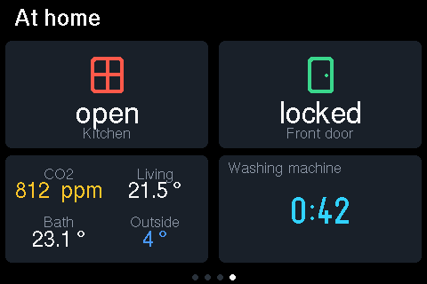

# Using Herald

The details behind the [README](../README.md): setting the device up, the web app, views, custom screens and the weather.

## First boot on real hardware

1. **Picture check.** On the TFT board the calibration screen should
   appear in landscape, white text on black. If the text is mirrored, the
   colours look negative or red and blue are swapped, change `LCD_MIRRORED`,
   `LCD_INVERTED` or `LCD_BGR` in `firmware/boards/freenove-35/src/board.rs`.
   A board standing the other way round is turned later with "Upside down"
   on the web app's Display page (touch follows).
2. **Touch calibration.** Press and hold each of the four crosses. If presses
   are not noticed, lower `TOUCH_PRESSURE_MIN` in `board.rs`.
3. **WiFi setup.** The display shows a network name (`Herald-XXXX`) and a
   password. Join it with a phone: the setup page opens by itself (captive
   portal), otherwise open the address shown. Enter your 2.4 GHz WiFi; the
   device restarts and connects. A tap on the screen (or any button)
   skips setup.
4. **Web app.** Open the device by its address or host name (`herald` by
   default; your router's DNS usually knows it, mDNS answers `herald.local`).

The serial log, and the System page, show free heap and UI frame times once a
minute. Without PSRAM this is the number to watch: it should stay well above
60 KB with WiFi connected.

## The web app

The device serves one gzipped page (about 23 KB) with an `ETag`, so a reload
costs nothing; all rendering happens in the browser.

- **Overview:** a mirror of the screen drawn from the device's state. Click it
  to tap the real screen, drag sideways to swipe, hold for the menu. View
  buttons, brightness, display on/off, WiFi signal, MQTT, uptime, memory.
- **Feed:** the items, with their age, and removal.
- **Screens:** your custom screens, and a builder with live preview that
  publishes them (see [Custom screens](guide.md#custom-screens)).
- **Display:** display language (English or German; the web app stays
  English), orientation (on the e-paper: upright or landscape), upside down,
  theme, accent colour, brightness, sleep, rotation, night mode. Controls a
  board cannot use are hidden.
- **Connections:** WiFi, host name, time zone, time server, MQTT, and the
  topic reference with your prefix filled in.
- **System:** firmware version and slot, update upload, restart, settings
  backup and restore, the device's log.

## Views, rotation and night mode

| View | Shows |
|---|---|
| Home | Clock, date, current weather, and the feed (up to five rows, most urgent first) |
| Forecast | Temperature curve and rain chance for the next 12 hours, cards for four days |
| Calendar | Weekday and date, ISO week, the month grid, sunrise, sunset and daylight |
| Your screens | Custom screens, ordered by name |

With rotation on, the device moves to the next view every `rotate_secs`
seconds, through `rotate_views` (view names, screen names, or `screens` for
all custom screens), between `rotate_from` and `rotate_until` (local time;
equal values mean all day, and the window may wrap past midnight). It pauses
for a minute after any touch.

Night mode dims the display to `night_brightness` (0 = off) between
`night_from` and `night_until`. A touch, or an item sent with `wake`, lights
it for `sleep_secs` (at least 30 s); a touch on a dark screen only wakes it.

## Custom screens



A screen is a retained MQTT message on `<prefix>/data/screen/<name>` (or
`PUT /api/screens/<name>`), with an optional title and 1 to 6 widgets laid out
automatically: 1 full, 2 side by side, 3 in a row, 4 as 2x2, 5–6 as 3x2. Up to
8 screens, 4 KB each; `lifetime` (seconds) removes a screen that is not
updated; an empty message removes it. Names are `a-z 0-9 - _`, and not the
name of a built-in view.

```json
{"title": "Energy", "lifetime": 900, "widgets": [
  {"type": "value", "label": "Solar now", "value": 3.2, "unit": "kW", "color": "yellow"},
  {"type": "gauge", "label": "Battery", "value": 64, "unit": "%",
   "zones": [{"to": 20, "color": "red"}, {"to": 100, "color": "green"}]},
  {"type": "chart", "label": "Today", "values": [0, 0.9, 2.6, 3.2, 1.1], "unit": "kW"},
  {"type": "list", "rows": [{"label": "Heat pump", "value": "1.4 kW"}]},
  {"type": "progress", "label": "Car charged", "value": 82},
  {"type": "countdown", "label": "Cheap power in", "until": 1795371000}]}
```

| Widget | Fields |
|---|---|
| `value` | `value` (text or number), `label`, `unit`, `color`, `digits` (seven-segment) |
| `gauge` | `value`, `min` (0), `max` (100), `label`, `unit`, `style` (`ring` or `bar`), `color`, `zones` |
| `chart` | `values` (up to 48), `min`, `max`, `style` (`line` or `bar`), `label`, `unit`, `color` |
| `list` | `rows`: up to 6 `{label, value, unit, color}`, `label` |
| `grid` | `tiles`: up to 6 `{label, value, unit, color}` |
| `progress` | `value`, `max` (100), `label`, `color` |
| `countdown` | `until` (Unix time), `label`, `color`; counts down on the device |
| `text` | `text` (up to 120 characters, wrapped), `size` (`small`, `medium`, `large`), `color` |
| `icon` | `icon`, `label`, `value`, `color` |
| `clock`, `weather` | no fields |

Colours are `red`, `yellow`, `blue`, `green`, `grey`, `white`, `accent`,
`"#RRGGBB"` or `[r, g, b]`. Icons: `window`, `door`, `temperature`,
`humidity`, `water`, `power`, `sun`, `moon`, `battery`, `mail`, `check`,
`warning`, `info`, `home`, `car`, `music`, `clock`, `bell`, `wind`. Numbers
may also be strings, as Home Assistant templates render them. To change a
value, publish the screen again; the device repaints only the widgets that
changed.
